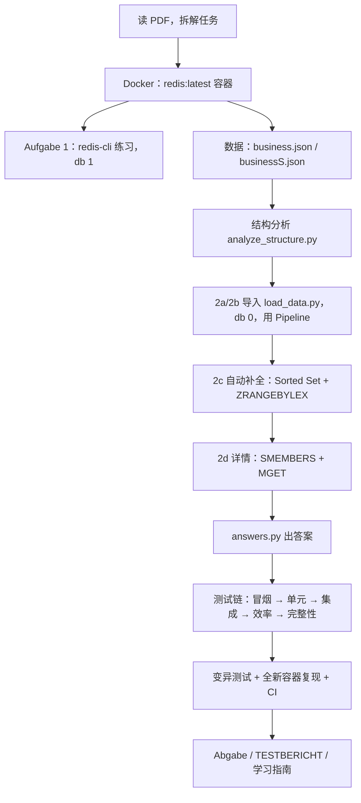

# Big Data – 1. Praktikum：Redis + Yelp Business 数据

HSBI · Prof. Dr. Stefan Berlik · WS 2026/27 · 截止 15.11.2026（ILIAS） · Zhaoze Yu (50293014)

> 📘 **想弄懂这次实践，先看 [`docs/学习指南.md`](docs/学习指南.md)**：从 Docker、Redis 数据类型，到 2a–2d 的设计和测试规范，每一节都有动手练习和自测题。

## 1. 任务复述

| 编号 | 原文要求 | 我要做的事 |
|---|---|---|
| 准备 | Docker 启动 Redis，解释 `docker run …` 命令；安装 redis-py；下载数据 | 官方镜像 `redis:latest`（8.10.3），逐项解释命令参数 |
| Aufgabe 1 | 用 redis-cli 练习 Strings / Lists / Sets / Hashes 的命令 | `cli/aufgabe1.redis`：82 条命令，带注释，在 db 1 里执行并记录输出 |
| 2 预备 | 分析文件结构（可用 businessS.json） | 格式是 JSON Lines，共 192,609 条；题目写的是 209,393 |
| 2a | 以 `business:<business_id>` 为键，存原始 JSON 字符串 | String |
| 2b | 小写商家名为键，值是 business_id 的集合 | Set |
| 2c | 前缀自动补全（`input()` 循环）；Starbucks 有几家；"The Still" 有几条；"The Sti" 补全出什么 | Sorted Set + `ZRANGEBYLEX` |
| 2d | 选中名字后取回 JSON，输出地址和星级；评价 "The Still" 的结果 | `SMEMBERS` + 一次 `MGET` |

## 2. 工作流

| 阶段 | 产出 | 命令 / 文件 |
|---|---|---|
| 一键执行 | `results/local/` 里的全部输出 | Windows：`deploy.bat`；Linux/CI：`scripts/run_praktikum1.sh` |
| Aufgabe 1 | 会话记录 | `cli/aufgabe1.redis` → `results/aufgabe1_session.txt`、`aufgabe1_redis_cli.md` |
| 结构分析 | 字段、类型、常见名字 | `analyze_structure.py` → `results/struktur.txt` |
| 2a/2b | 336,947 个键 | `load_data.py data/business.json --flush` |
| 2c/2d | 答案、交互演示 | `answers.py`、`autocomplete.py`（双击 `autocomplete.bat`） |
| 测试 | 48 个测试 | `run_tests.py`（双击 `run_tests.bat`） |

## 3. 进度

| 步骤 | 状态 | 说明 |
|---|---|---|
| 任务拆解、方案设计 | ✅ | |
| 第一版（2026-11-09） | ✅ | 云端跑出真实答案；当时本地没有 Docker，用的是便携版 Redis |
| 升级到 Docker + 五级测试链（2026-11-18） | ✅ | 和 Praktikum 2 用同一套规范 |
| 变异测试 6 个 | ✅ | 发现集成测试 i02 太弱，已经加强 |
| 全新容器复现 | ✅ | 48/48 |
| CI（Python 3.10/3.13 × Redis 5/8，从 Sciebo 下载真实数据） | ✅ | 发现并修好了 `.sh` 脚本里下载链接和文件对应反了的 bug |
| 部署到 `T:\新学期\大数据\Big_Data_Praktikum_1\Praktikum1` | ✅ | 代码和数据都已就位 |
| 本地 Windows 运行 | ⏳ | 双击桌面 `HSBI\Praktikum1_deploy.bat` |
| 学习指南 + 一起过一遍 | ⏳ | `docs/学习指南.md` |

## 4. 答案（真实数据）

| 问题 | 答案 |
|---|---|
| 记录数 | 192,609（题目写 209,393，是另一个版本的数据集） |
| 键总数 | 336,947 = 192,609 `business:*` + 144,337 名字集合 + 1 个索引；内存约 188 MB |
| "Star" 补全 | 181 个名字（包括 starbucks、starlight nails & spa；最后一个是 star火bbq） |
| Starbucks | 名字恰好是 starbucks：**1,066** 家；以 starbucks 开头的全部：**1,073** 家 |
| "The Still" | **2** 条 |
| "The Sti" 补全 | the still、the stirling club spa、the stirling room |
| "The Still" 详情 | Las Vegas NV，3.5★（257 条评论）；Calgary AB，2.5★（8 条评论） |
| 评价 | 两家是互不相关的店：**名字不是唯一标识**（详见学习指南第 7 节和 Abgabe） |
| 效率 | 补全只用 1 次 `ZRANGEBYLEX`，0.7 ms；用 SCAN 做同样的事要 337 次调用、195 ms |

## 5. 文件说明

见 [`docs/学习指南.md`](docs/学习指南.md) 第 9 节"文件地图"。德语提交稿：`Abgabe.md`；测试报告：`TESTBERICHT.md`。
