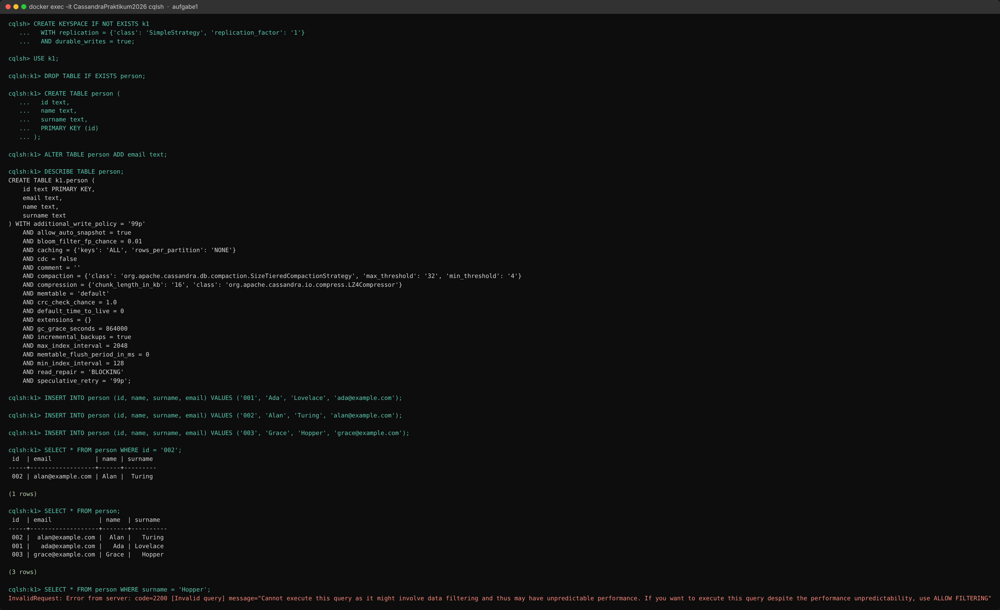
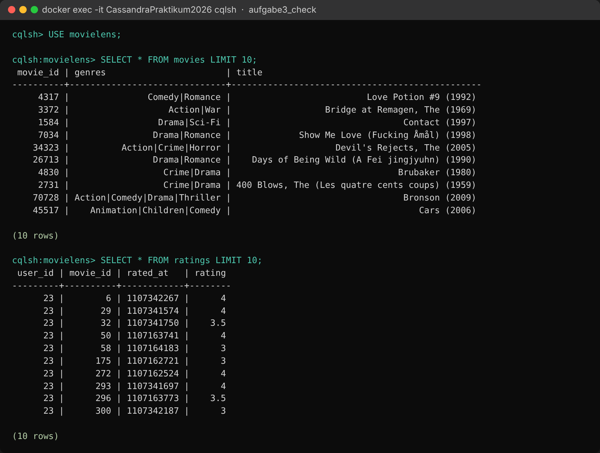
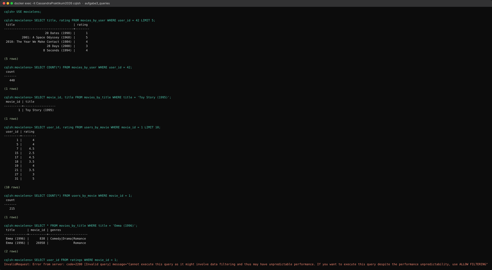

# Big Data – 2. Praktikum (Abgabe)

**Name:** Zhaoze Yu · **Matrikelnr.:** 50293014 · WS 2026/27

Cassandra und ein Auszug aus dem MovieLens-Datensatz (`ml-latest-small`). Alle Befehle und Ausgaben stammen aus echten Läufen gegen das offizielle Docker-Image (`cassandra:latest` = **Cassandra 5.0.9**, cqlsh 6.2.0, CQL 3.4.7, Native Protocol v5). Die vollständigen Protokolle liegen in `results/`, die Screenshots in `docs/screenshots/`.

## Vorbereitung

```bash
docker pull cassandra
docker run --name CassandraPraktikum2026 -p 9042:9042 -d cassandra:latest
docker exec -it CassandraPraktikum2026 cqlsh
```

- `-p 9042:9042` macht den CQL-Port (Native Protocol) für den Python-Treiber auf dem Host erreichbar.
- `-d` startet den Container im Hintergrund.
- Der erste Start dauert etwa eine Minute (Bootstrap des Knotens). Bereit ist der Knoten, sobald `cqlsh -e "SELECT release_version FROM system.local"` antwortet.

## Aufgabe 1: Fingerübungen

Ablauf nach dem Tutorial *Getting Started With Cassandra: Using CQL API and CQLSH* (Skript `cql/aufgabe1_person.cql`, Protokoll `results/aufgabe1_session.txt`, Screenshot `docs/screenshots/aufgabe1.png`):

```sql
CREATE KEYSPACE IF NOT EXISTS k1
  WITH replication = {'class': 'SimpleStrategy', 'replication_factor': '1'}
  AND durable_writes = true;
USE k1;
CREATE TABLE person (id text, name text, surname text, PRIMARY KEY (id));
ALTER TABLE person ADD email text;
DESCRIBE TABLE person;
INSERT INTO person (id, name, surname, email) VALUES ('001', 'Ada', 'Lovelace', 'ada@example.com');
INSERT INTO person (id, name, surname, email) VALUES ('002', 'Alan', 'Turing', 'alan@example.com');
INSERT INTO person (id, name, surname, email) VALUES ('003', 'Grace', 'Hopper', 'grace@example.com');
SELECT * FROM person WHERE id = '002';
SELECT * FROM person;
```

Ergebnisse:

```
cqlsh:k1> SELECT * FROM person WHERE id = '002';
 id  | email            | name | surname
-----+------------------+------+---------
 002 | alan@example.com | Alan |  Turing
(1 rows)

cqlsh:k1> SELECT * FROM person;
 id  | email             | name  | surname
-----+-------------------+-------+----------
 002 |  alan@example.com |  Alan |   Turing
 001 |   ada@example.com |   Ada | Lovelace
 003 | grace@example.com | Grace |   Hopper
(3 rows)
```



Beobachtungen:

- **`DESCRIBE TABLE`** zeigt neben den Spalten alle Standardoptionen der Tabelle, z. B. `compaction = SizeTieredCompactionStrategy`, `compression = LZ4Compressor`, `gc_grace_seconds = 864000` und `default_time_to_live = 0`. Der Primärschlüssel steht als `id text PRIMARY KEY`.
- **Die Ausgabereihenfolge** von `SELECT *` ist 002, 001, 003, also weder die Einfüge- noch die alphabetische Reihenfolge. Es ist die **Token-Reihenfolge**: der Murmur3-Hash des Partition Keys bestimmt die Position im Ring.
- **Suche über eine Nicht-Schlüsselspalte** wird abgelehnt:
  ```
  SELECT * FROM person WHERE surname = 'Hopper';
  InvalidRequest: ... Cannot execute this query as it might involve data filtering ... use ALLOW FILTERING
  ```
  Effizient suchen kann man nur über den Partition Key. Das ist der Kern des abfragegetriebenen Modells aus Aufgabe 2.

## Aufgabe 2: Cassandra Details verstehen

Die Stichwortnotizen zu *Architecture*, *Data Modeling* und *CQL* stehen vollständig im **Anhang A** (auch als `docs/aufgabe2_notizen.md`). Mit ✔ markierte Punkte wurden in diesem Praktikum direkt überprüft.

Die wichtigsten Punkte:

- **Architektur**: masterloser Ring; Consistent Hashing mit Murmur3-Tokens und vnodes; Replikation pro Keyspace (`SimpleStrategy` oder `NetworkTopologyStrategy`); Tunable Consistency mit der Regel R + W > RF; Gossip und Phi-Accrual-Ausfallerkennung; Hinted Handoff, Read Repair und Merkle-Tree-Repair.
- **Storage Engine**: Schreibpfad Commit Log → Memtable → unveränderliche SSTables; Compaction; Tombstones.
- **Data Modeling**: query-first; eine Tabelle pro Abfrage; Denormalisierung ist gewollt. Primärschlüssel = Partition Key + Clustering Columns. Ziele: Daten gleichmäßig verteilen und möglichst eine Partition pro Abfrage lesen. Partitionsgröße abschätzen mit `Nv = Nr · (Nc − Npk − Ns) + Ns`.
- **CQL**: SQL-ähnliche Syntax, aber `WHERE` nur auf Schlüsselspalten (sonst `ALLOW FILTERING`), `ORDER BY` nur auf Clustering Columns, INSERT und UPDATE sind Upserts, keine Joins. `COPY` und `DESCRIBE` sind cqlsh-Befehle, kein CQL.

## Aufgabe 3: Arbeiten mit dem MovieLens Dataset

### Vorbereitung im Container

Wie im Aufgabenblatt: `bash`, `apt-get update && apt-get dist-upgrade`, `apt-get -y install unzip nano wget`, `mkdir /home/cassandra`, `wget https://files.grouplens.org/datasets/movielens/ml-latest-small.zip`, `unzip ml-latest-small.zip`. Unter Windows erledigt das Skript `deploy.bat` diese Schritte automatisch.

Der Datensatz stimmt mit seiner README überein: **9 742 Filme, 100 836 Bewertungen, 610 Nutzys** (geprüft in `test_g01`).

### a) Keyspace `movielens`

```sql
CREATE KEYSPACE IF NOT EXISTS movielens
  WITH replication = {'class': 'SimpleStrategy', 'replication_factor': 1};
USE movielens;
```

`SimpleStrategy` mit RF 1 passt zu einem einzelnen Knoten. In einem Cluster mit mehreren Rechenzentren würde man `NetworkTopologyStrategy` mit RF 3 pro Rechenzentrum wählen.

### b) Tabellen des Datensatzes

| Datei | Zeilen | Spalten | Bemerkungen |
|---|---:|---|---|
| `movies.csv` | 9 742 | `movieId, title, genres` | Titel mit Jahr in Klammern; Artikel nachgestellt („Matrix, The (1999)“); 2 079 Titel mit Komma und deshalb in Anführungszeichen; 1 Titel mit `"` im Namen (als `""` kodiert); 293 Titel mit Nicht-ASCII-Zeichen; **5 Titel kommen doppelt vor** (verschiedene Filme, z. B. zwei Mal „Emma (1996)“); Genres durch `\|` getrennt |
| `ratings.csv` | 100 836 | `userId, movieId, rating, timestamp` | sortiert nach userId, dann movieId; (userId, movieId) eindeutig; Bewertungen 0,5–5,0 in 0,5-Schritten; timestamp in Sekunden seit 1970 (UTC); jede movieId existiert in movies.csv |
| `tags.csv` | 3 683 | `userId, movieId, tag, timestamp` | freie Schlagworte (hier nicht benötigt) |
| `links.csv` | 9 742 | `movieId, imdbId, tmdbId` | Verweise auf IMDb und TMDb (hier nicht benötigt) |

### c) Schema und Import mit COPY

```sql
CREATE TABLE movies (
  movie_id int PRIMARY KEY,
  title    text,
  genres   text            -- laut Hinweis als einfacher Text
);

CREATE TABLE ratings (
  user_id  int,
  movie_id int,
  rating   float,
  rated_at bigint,         -- Sekunden; der CQL-Typ timestamp erwartet Millisekunden
  PRIMARY KEY ((user_id), movie_id)
);

COPY movies (movie_id, title, genres)
  FROM '/home/cassandra/ml-latest-small/movies.csv' WITH HEADER = true AND ESCAPE = '"';
COPY ratings (user_id, movie_id, rating, rated_at)
  FROM '/home/cassandra/ml-latest-small/ratings.csv' WITH HEADER = true;
```

Ergebnis: `9742 rows imported … (0 skipped)` und `100836 rows imported … (0 skipped)`.

**Wichtiges Detail – `ESCAPE = '"'`**: Die CSV kodiert ein Anführungszeichen im Feld als `""` (RFC 4180). Das Standard-Escape-Zeichen von `COPY` ist aber der Backslash. Ohne die Option wird der Titel `11'09"01 - September 11 (2002)` falsch importiert, nämlich mit einem zusätzlichen `"` am Ende. Mit der Option sind alle 9 742 Titel Feld für Feld identisch mit der CSV (`test_g03`, `test_g08`).

### d) Kontrolle: jeweils die ersten 10 Zeilen

```sql
SELECT * FROM movies LIMIT 10;
SELECT * FROM ratings LIMIT 10;
```

```
 movie_id | genres                       | title
----------+------------------------------+------------------------------------------------
     4317 |               Comedy|Romance |                          Love Potion #9 (1992)
     3372 |                   Action|War |                  Bridge at Remagen, The (1969)
     1584 |                 Drama|Sci-Fi |                                 Contact (1997)
     7034 |                Drama|Romance |             Show Me Love (Fucking Åmål) (1998)
    34323 |          Action|Crime|Horror |                    Devil's Rejects, The (2005)
    26713 |                Drama|Romance |    Days of Being Wild (A Fei jingjyuhn) (1990)
     4830 |                  Crime|Drama |                                Brubaker (1980)
     2731 |                  Crime|Drama | 400 Blows, The (Les quatre cents coups) (1959)
    70728 | Action|Comedy|Drama|Thriller |                                 Bronson (2009)
    45517 |    Animation|Children|Comedy |                                    Cars (2006)

 user_id | movie_id | rated_at   | rating
---------+----------+------------+--------
      23 |        6 | 1107342267 |      4
      23 |       29 | 1107341574 |      4
      23 |       32 | 1107341750 |    3.5
      23 |       50 | 1107163741 |      4
      23 |       58 | 1107164183 |      3
      23 |      175 | 1107162721 |      3
      23 |      272 | 1107162524 |      4
      23 |      293 | 1107341697 |      4
      23 |      296 | 1107163773 |    3.5
      23 |      300 | 1107342187 |      3
```



Die „ersten 10 Zeilen“ sind nicht die ersten Zeilen der CSV, sondern die ersten in **Token-Reihenfolge**. Bei `ratings` gehören alle zehn zur Partition von Nutzy 23 (dem kleinsten Token) und sind dort nach der Clustering Column `movie_id` sortiert. Daran sieht man direkt das Speicherlayout: Partitionen werden über den Ring verteilt, Zeilen sind innerhalb einer Partition sortiert.

### e) „Welche Filme hat ein Nutzy bewertet?“

**Zugriffsmuster:** gegeben `user_id`, gesucht alle bewerteten Titel, alphabetisch sortiert.

**Warum nicht die Tabelle `ratings`?** Sie enthält keine Titel; Cassandra kann nicht joinen und sortiert innerhalb einer Partition nur nach Clustering Columns (`ORDER BY rating` → InvalidRequest, `test_l06`). Daher nach den Regeln aus *Data Modeling* eine eigene, denormalisierte Tabelle für genau diese Abfrage:

```sql
CREATE TABLE movies_by_user (
  user_id  int,
  title    text,
  movie_id int,
  rating   float,
  rated_at bigint,
  PRIMARY KEY ((user_id), title, movie_id)
) WITH CLUSTERING ORDER BY (title ASC, movie_id ASC);
```

| Entwurfsentscheidung | Begründung |
|---|---|
| Partition Key `user_id` | Die Abfrage liest **genau eine Partition**. 610 Nutzys verteilen die Daten gut über den Ring. |
| Clustering Column `title ASC` | Die Zeilen liegen schon **alphabetisch sortiert auf der Platte**; es wird beim Lesen nicht sortiert. |
| zusätzlich `movie_id` im Schlüssel | 5 Titel kommen doppelt vor. Mit `(user_id, title)` allein würde die zweite Bewertung desselben Titels die erste überschreiben (Upsert). Gegenprobe: Ohne `movie_id` schlagen 4 Tests fehl. |
| Partitionsgröße | Größte Partition: 2 698 Zeilen · 2 Werte ≈ 5 400 Werte, weit unter den kritischen Größen (`test_l07`). |

Befüllt wird die Tabelle durch einen einmaligen Join beim Laden: `denormalize.py` erzeugt aus den beiden CSV-Dateien `movies_by_user.csv`, die dann ebenfalls per `COPY` importiert wird. Cassandra kennt kein `INSERT … SELECT`, und Materialized Views sind in Cassandra 5 standardmäßig deaktiviert („Materialized views are disabled“).

```sql
SELECT title, rating FROM movies_by_user WHERE user_id = 42 LIMIT 5;
```

**Die ersten 5 Filme, die Nutzy 42 bewertet hat (alphabetisch):**

| # | Titel | Bewertung |
|---|---|---:|
| 1 | 20 Dates (1998) | 1.0 |
| 2 | 2001: A Space Odyssey (1968) | 5.0 |
| 3 | 2010: The Year We Make Contact (1984) | 4.0 |
| 4 | 28 Days (2000) | 3.0 |
| 5 | 8 Seconds (1994) | 4.0 |

Nutzy 42 hat insgesamt 440 Filme bewertet. Das Ergebnis wurde unabhängig geprüft: gleiche Liste beim Sortieren der CSV-Daten in Python (`test_g12`).



Anmerkungen zur Sortierung:

- Sortiert wird nach **UTF-8-Bytes**. Ziffern stehen daher vor Buchstaben, Großbuchstaben vor Kleinbuchstaben („eXistenZ (1999)“ nach „Toy Story (1995)“), Sonderzeichen nach ASCII.
- Da MovieLens Artikel nachstellt („Matrix, The“), entspricht das für englische Titel weitgehend der üblichen alphabetischen Sortierung.
- Für eine Sortierung unabhängig von Groß- und Kleinschreibung könnte man zusätzlich eine normalisierte Spalte (z. B. `lower(title)`) als Clustering Column verwenden.

**Effizienz nachgewiesen** (Query-Tracing, `results/tracing.txt`):

```
e) SELECT title FROM movies_by_user WHERE user_id = 42 LIMIT 5
   Executing single-partition query on movies_by_user       -> 5 Zeilen, 2,7 ms
Gegenprobe: SELECT user_id FROM ratings WHERE movie_id = 1 ALLOW FILTERING
   Submitting range requests on 17 ranges ... Executing seq scan across 3 sstables  -> 9,9 ms
```

### f) „Welches Nutzy hat einen Film bewertet?“

Das ist das umgekehrte Zugriffsmuster, also nach dem query-first-Prinzip eine weitere Tabelle mit denselben Fakten:

```sql
CREATE TABLE users_by_movie (
  movie_id int,
  user_id  int,
  title    text STATIC,        -- Titel nur einmal pro Partition gespeichert
  rating   float,
  rated_at bigint,
  PRIMARY KEY ((movie_id), user_id)
) WITH CLUSTERING ORDER BY (user_id ASC);

CREATE TABLE movies_by_title (  -- Hilfstabelle: Nutzer kennen den Titel, nicht die movie_id
  title    text,
  movie_id int,
  genres   text,
  PRIMARY KEY ((title), movie_id)  -- ein Titel kann mehrere Filme bezeichnen
);
```

Beispiel „Toy Story (1995)“: Abfrage in zwei Schritten mit jeweils einer Partition.

```sql
SELECT movie_id FROM movies_by_title WHERE title = 'Toy Story (1995)';    -- 1
SELECT user_id, rating FROM users_by_movie WHERE movie_id = 1;            -- 215 Nutzys
```

Ergebnis: **215 Nutzys** haben „Toy Story (1995)“ bewertet (Durchschnitt 3,92). Die ersten zehn sind 1, 5, 7, 15, 17, 18, 19, 21, 27, 31 (geprüft in `test_g13`). Bei doppelten Titeln liefert die Hilfstabelle mehrere `movie_id`s, z. B. „Emma (1996)“ → 838 und 26958.

Auf der Basistabelle wäre dieselbe Frage nicht effizient: `SELECT user_id FROM ratings WHERE movie_id = 1` wird ohne `ALLOW FILTERING` abgelehnt, und mit `ALLOW FILTERING` durchsucht Cassandra alle Partitionen.

Der Preis der Lösung: Jede Bewertung ist dreifach gespeichert (`ratings`, `movies_by_user`, `users_by_movie`). Bei Änderungen muss die Anwendung alle Kopien pflegen, z. B. mit einem `BATCH`. Dass die drei Kopien hier konsistent sind, prüfen `test_g05` und `test_g06`.

### g) Unterschiede zu klassischen SQL-Datenbanken

| | Relationale DB (SQL) | Cassandra |
|---|---|---|
| **Modellierung** | Entitäten zuerst, normalisiert (3NF); Abfragen kommen später | Abfragen zuerst; **eine Tabelle pro Abfrage**, bewusst denormalisiert und dupliziert (hier 3 Kopien jeder Bewertung) |
| **Joins / Unterabfragen** | Kernfunktion | gibt es nicht; der Join passiert beim Laden (`denormalize.py`) |
| **WHERE / ORDER BY** | beliebige Spalten; Indizes optional zur Beschleunigung | nur Partition Key (vollständig) und Clustering Columns in Reihenfolge; Sortierung ist beim Tabellenentwurf festgelegt; alles andere → `ALLOW FILTERING` (Scan) |
| **Primärschlüssel** | eindeutige Kennung; Duplikat → Fehler | bestimmt zusätzlich die **Verteilung** (Partition Key → Knoten) und die **Sortierung** (Clustering); INSERT auf vorhandenen Schlüssel = **Upsert** ohne Fehler (dieser Fall hätte bei den doppelten Titeln Bewertungen verloren) |
| **Transaktionen und Konsistenz** | ACID über mehrere Tabellen | keine Transaktionen über mehrere Partitionen; atomar nur pro Partition, Lightweight Transactions (Paxos), logged BATCH; **tunable** Konsistenz pro Anfrage, standardmäßig eventual consistency |
| **Skalierung und Ausfallsicherheit** | meist vertikal; Primär/Replikat; Sharding ist aufwendig | horizontal; masterloser Ring; Replikation und Verteilung eingebaut; kein Single Point of Failure |
| **Schreiben** | Update in place, Sperren | Append-only (Commit Log, Memtable, SSTables), keine Leseoperation vor dem Schreiben → sehr schneller Durchsatz; Löschen erzeugt Tombstones |
| **Schema** | strikt, `ALTER` oft teuer | ebenfalls ein Schema mit Typen (keine „schemalose“ DB), aber Spalten hinzufügen kostet nichts, und viele Spalten pro Zeile können leer bleiben |
| **Werkzeuge** | SQL ist standardisiert | CQL sieht aus wie SQL, verhält sich aber anders. `COPY` und `DESCRIBE` sind Funktionen von cqlsh und kein Teil der Sprache. |

**Fazit:** Relationale Datenbanken optimieren *flexible Abfragen* auf einem konsistenten, normalisierten Datenbestand. Cassandra optimiert *vorher bekannte Abfragen* auf sehr großen, verteilten Datenmengen bei hoher Schreiblast und Verfügbarkeit. Der Preis dafür: Die Anwendung muss ihre Zugriffsmuster vorab festlegen und die Duplikate selbst konsistent halten.

## Qualitätssicherung

Testkette `run_tests.py` mit 54 Tests in 5 Stufen (Details im Testbericht `TESTBERICHT.md`):

| Stufe | Tests | Ergebnis |
|---|---:|---|
| 1 Smoke | 5 | ✅ |
| 2 Unit (ohne Datenbank) | 16 | ✅ |
| 3 Integration (Test-Keyspace) | 13 | ✅ |
| 4 Lokalität (Query-Tracing: eine Partition pro Abfrage) | 7 | ✅ |
| 5 Datenintegrität (alle Tabellen Feld für Feld gegen die CSV-Dateien) | 13 | ✅ |

---

## Anhang A – Stichwortnotizen zu Aufgabe 2

(Inhalt identisch mit `docs/aufgabe2_notizen.md`.)

Quellen: Cassandra-Dokumentation, Abschnitte *Architecture* (Overview, Dynamo, Storage Engine, Guarantees), *Data Modeling* und *The Cassandra Query Language (CQL)*. Wo eine Aussage durch dieses Praktikum direkt überprüft wurde, steht ein ✔ mit Verweis.

### 1. Architecture

#### Überblick
- Verteilte, partitionierte **Wide-Column-Datenbank**, ursprünglich bei Facebook entstanden. Vorbilder: **Amazon Dynamo** (Verteilung, Replikation) und **Google Bigtable** (Datenmodell, Storage Engine).
- **Kein Master**: alle Knoten sind gleichberechtigt (peer-to-peer). Jeder Knoten kann als **Coordinator** Anfragen annehmen.
- Ausgelegt auf **Hochverfügbarkeit**, **lineare horizontale Skalierung** (scale-out) und günstige Standardhardware, bei der Ausfälle der Normalfall sind.
- Keine Transaktionen über Partitionen hinweg. Unterstützt werden atomare Operationen auf einer Partition und **Lightweight Transactions** (Compare-and-Set mit Paxos).
- Schemaänderungen betreffen nur Metadaten und laufen im laufenden Betrieb.

#### Dynamo: Verteilung und Replikation
- **Partitionierung per Consistent Hashing**: Der **Partitioner** (Standard `Murmur3Partitioner`, ✔ `cassandra.yaml` im Container) bildet den Partition Key auf einen **Token** (64 Bit) ab. Die Knoten bilden einen **Token-Ring**, jeder Knoten besitzt Token-Bereiche.
- Knoten hinzufügen oder entfernen verschiebt nur einen kleinen Teil der Schlüssel (anders als Hashing mit Modulo).
- **Virtuelle Knoten (vnodes)**: Jeder physische Knoten besitzt mehrere Tokens (`num_tokens`, ✔ im offiziellen Image 16). Das verteilt Daten und Last gleichmäßiger, auch beim Hinzufügen und Entfernen von Knoten. Nachteil: mehr Ring-Nachbarn, Repairs dauern länger. Die neuere deterministische Token-Vergabe braucht deutlich weniger Tokens als die früher üblichen 256.
- **Replikation** pro Keyspace mit dem **Replication Factor (RF)**:
  - `SimpleStrategy`: ein RF für den ganzen Cluster, ignoriert Rechenzentren und Racks. Nur für Tests und Einzelknoten. ✔ hier verwendet: 1 Knoten, RF 1.
  - `NetworkTopologyStrategy`: RF pro Rechenzentrum, verteilt Replikate auf verschiedene Racks. Für Produktion empfohlen, auch bei nur einem Rechenzentrum.
- **Multi-Master**: Jedes Replikat nimmt Schreibzugriffe an. Konflikte werden über **Zeitstempel pro Zelle** gelöst (**Last Write Wins**), daher ist Uhrensynchronisation (NTP) wichtig.
- **Abgleich der Replikate**: **Hinted Handoff** (der Coordinator merkt sich Writes für einen ausgefallenen Knoten), **Read Repair** (Abweichungen beim Lesen werden korrigiert) und **Anti-Entropy-Repair** mit **Merkle Trees** (`nodetool repair`, voll, teilbereichsweise oder inkrementell).
- **Gossip**: Knoten tauschen jede Sekunde Statusinformationen aus (Heartbeat, Tokens, Schema-Version) mit zufälligen Nachbarn und mit **Seed-Knoten**.
- **Ausfallerkennung**: Jeder Knoten entscheidet selbst mit dem **Phi-Accrual-Failure-Detector**. Der Status UP/DOWN wird nicht per Gossip verteilt. Entfernt wird ein Knoten nur explizit (decommission oder replace).

#### Tunable Consistency
- Der **Consistency Level** wird pro Anfrage gewählt. Schreibzugriffe gehen immer an alle Replikate; der Level bestimmt nur, auf wie viele Bestätigungen der Coordinator wartet.
- Levels: `ONE`, `TWO`, `THREE`, `QUORUM` (Mehrheit aller Replikate), `ALL`, `LOCAL_QUORUM`, `EACH_QUORUM`, `LOCAL_ONE`, `ANY` (nur Writes: auch ein gespeicherter Hint zählt).
- **Starke Konsistenz**, wenn **R + W > RF** gilt, z. B. bei RF 3 `QUORUM` für Lesen und Schreiben. Niedrigere Levels bringen geringere Latenz und höhere Verfügbarkeit, dafür nur **eventual consistency**.
- Einordnung im **CAP-Theorem**: standardmäßig AP; über den Consistency Level verschiebbar in Richtung CP.

#### Storage Engine (Schreib- und Lesepfad)
- **Schreiben**: zuerst sequenziell in das **Commit Log** (Dauerhaftigkeit, abschaltbar mit `durable_writes = false`), dann in die **Memtable** (sortiert, im Arbeitsspeicher). Ist die Memtable voll, wird sie als **SSTable** auf die Platte geschrieben (*flush*).
- **SSTables sind unveränderlich**. Update und Delete schreiben neue Versionen; Deletes erzeugen **Tombstones**, die nach `gc_grace_seconds` (Standard 10 Tage) entfernt werden. Deshalb sind Writes sehr schnell: kein Read-before-Write.
- **Compaction** führt SSTables zusammen und entfernt veraltete Daten. Strategien: `SizeTiered` (Standard), `Leveled`, `TimeWindow`, ab 5.0 zusätzlich `UnifiedCompactionStrategy`.
- **Lesen**: Memtable plus die betroffenen SSTables zusammenführen. Pro SSTable helfen **Bloom-Filter** (ist der Schlüssel enthalten?), Key-Cache und Partition-Index. ✔ Tracing in `results/tracing.txt`: „Merged data from memtables and 3 sstables“, „Key cache hit“.

### 2. Data Modeling

- **Query-first**: Zuerst die Anwendungsabfragen (Access Patterns) festlegen, dann die Tabellen daraus ableiten. In relationalen DBs ist es umgekehrt: erst die Entitäten, dann die Abfragen.
- Vorgehen laut Dokumentation: konzeptionelles Modell (ER) → **Anwendungsabfragen definieren** → **logisches Modell** (Chebotko-Diagramme: Tabellen, Partition Key **K**, Clustering Column **C↑/C↓**, statische Spalten **S**) → **physisches Modell** (Datentypen) → **Bewerten und Verfeinern** → Schema.
- **Eine Tabelle pro Abfrage** (bzw. pro Gruppe von Abfragen). **Denormalisierung und Duplikation sind gewollt**: Speicher ist billig, Joins gibt es nicht. ✔ Hier: `movies_by_user` und `users_by_movie` enthalten dieselben Bewertungen.
- **Primärschlüssel** = **Partition Key** (bestimmt den Knoten; alle Zeilen mit gleichem Key liegen zusammen) + **Clustering Columns** (Sortierung innerhalb der Partition, auf der Platte vorsortiert).
- Ziele für jede Tabelle:
  1. Daten **gleichmäßig über den Cluster verteilen** (Partition Key mit hoher Kardinalität, keine Hotspots);
  2. **möglichst wenige Partitionen pro Abfrage** lesen, idealerweise genau eine. ✔ `tests/test_3_locality.py`
- **Partitionsgröße abschätzen**: Anzahl Werte `Nv = Nr · (Nc − Npk − Ns) + Ns` (Zeilen · (Spalten − Primärschlüsselspalten − statische Spalten) + statische Spalten). Hartes Limit: 2 Milliarden Zellen pro Partition; Performanceprobleme treten schon viel früher auf. Rechnen mit dem Worst Case, nicht nur mit dem Durchschnitt.
- Zu große Partitionen aufteilen durch **Bucketing**: zusätzliche Spalte im Partition Key, z. B. Monat (Beispiel Hotel-Verfügbarkeit). Zu kleine Partitionen verteilen zusammengehörige Daten unnötig.
- Beispieldomäne der Dokumentation: **Hotel-Reservierung** (Hotels nahe einer Sehenswürdigkeit, freie Zimmer, Reservierungen nach Gast usw.), jeweils mit eigener Tabelle pro Abfrage.
- **Eindeutigkeit beachten**: Der Primärschlüssel muss eine Zeile eindeutig identifizieren, sonst überschreibt ein INSERT eine andere Zeile (Upsert). ✔ Doppelte Titel im Datensatz → `movie_id` als zusätzliche Clustering Column.

### 3. The Cassandra Query Language (CQL)

#### Datentypen
- **Native Typen**: `text`/`varchar`, `ascii`, `int`, `bigint`, `smallint`, `tinyint`, `varint`, `float`, `double`, `decimal`, `boolean`, `uuid`, `timeuuid`, `timestamp` (Millisekunden), `date`, `time`, `duration`, `inet`, `blob`, `counter`. Ab 5.0 außerdem `vector<float, n>` für Vektorsuche.
- **Collections**: `list<T>`, `set<T>`, `map<K,V>` (für kleine Datenmengen gedacht); `frozen<…>` werden als ein einziger Wert gespeichert.
- **User-Defined Types** (`CREATE TYPE`) und **Tupel**.

#### DDL
- `CREATE KEYSPACE … WITH replication = {…}` (Pflichtangabe) `AND durable_writes = true`. `USE` setzt den aktuellen Keyspace.
- `CREATE TABLE … PRIMARY KEY ((pk1, pk2), ck1, ck2) WITH CLUSTERING ORDER BY (ck1 ASC/DESC)`. Die Sortierung ist nachträglich nicht änderbar.
- **Statische Spalten** (`STATIC`): ein Wert pro Partition, nur in Tabellen mit Clustering Columns erlaubt. ✔ `users_by_movie.title`
- Tabellenoptionen: `compaction`, `compression` (Standard LZ4), `default_time_to_live`, `gc_grace_seconds`, `caching`, `bloom_filter_fp_chance` u. a. ✔ sichtbar in `DESCRIBE TABLE person`.
- `ALTER TABLE … ADD/DROP` (nicht für Primärschlüsselspalten), `DROP`, `TRUNCATE`.

#### DML
- `SELECT`: Im `WHERE` sind nur der **vollständige Partition Key** (= oder IN) und danach **Clustering Columns in Reihenfolge** erlaubt (Präfix; Bereichsbedingungen nur auf die letzte genutzte Spalte).
- Andere Bedingungen erfordern `ALLOW FILTERING`, d. h. einen Scan über den Cluster. ✔ Fehlermeldung in Aufgabe 1 und 3; Tracing zeigt „range requests … seq scan“.
- `ORDER BY` nur nach Clustering Columns (in deklarierter oder genau umgekehrter Reihenfolge). `LIMIT`, `PER PARTITION LIMIT`, `GROUP BY` (nach Primärschlüsselspalten), Aggregate wie `COUNT`, `MIN`, `MAX`, `AVG`, `SUM`.
- `INSERT` und `UPDATE` sind beide **Upserts**: kein Fehler bei vorhandenem Schlüssel, kein Lesen vorher. ✔ `test_i13_insert_is_upsert`
- `USING TTL` (Ablauf in Sekunden), `USING TIMESTAMP`.
- **Lightweight Transactions**: `INSERT … IF NOT EXISTS`, `UPDATE … IF …` (Paxos, deutlich teurer).
- `BATCH`: atomar, gedacht für mehrere denormalisierte Tabellen, **nicht** zur Beschleunigung; `UNLOGGED` und `COUNTER` als Varianten.
- `DELETE` erzeugt Tombstones.

#### Weitere Konzepte
- **Sekundärindizes**: klassische 2i (nur bei mittlerer Kardinalität sinnvoll) und **Storage-Attached Indexing (SAI)** ab 5.0 (`CREATE INDEX … USING 'sai'`).
- **Materialized Views**: automatisch gepflegte Abfragetabellen, gelten als experimentell und sind in 5.0 standardmäßig deaktiviert. ✔ `CREATE MATERIALIZED VIEW` liefert „Materialized views are disabled“.
- Benutzerdefinierte Funktionen und Aggregate (UDF/UDA), Trigger, Rollen und Rechte (`CREATE ROLE`, `GRANT`), JSON-Unterstützung (`SELECT JSON`, `INSERT … JSON`).
- **cqlsh** ist die Kommandozeile. `COPY TO/FROM` (CSV-Import und -Export) und `DESCRIBE` sind **cqlsh-Befehle, kein CQL**; deshalb gibt es sie im Python-Treiber nicht. ✔ Wichtige COPY-Optionen: `HEADER`, `DELIMITER`, `QUOTE`, `ESCAPE` (Standard `\`; für CSV mit `""` ist `ESCAPE = '"'` nötig).
