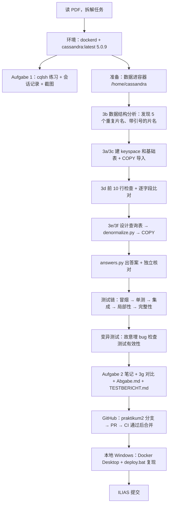

# Big Data – 2. Praktikum：Cassandra + MovieLens

HSBI · Prof. Dr. Stefan Berlik · WS 2026/27 · **截止 24.11.2026（ILIAS 提交）** · Zhaoze Yu (50293014)

## 1. 任务复述（我的理解）

本次实践用 **Cassandra**（分布式宽列数据库）处理 MovieLens 小数据集（9,742 部电影、100,836 条评分）。核心是体会"**先想查询，再设计表**"的 NoSQL 建模方式，并和关系型数据库对比。

| 编号 | 原文要求 | 我要做的事 |
|---|---|---|
| 准备 | `docker pull cassandra`，启动容器 | 用官方镜像起一个 Cassandra 5 容器，暴露 9042 端口 |
| Aufgabe 1 | cqlsh 练习，参照 tutsplus 教程 | 建 keyspace `k1` → 建 `person` 表 → `DESCRIBE` → 插 3 条 → 按 id 查一人 → 全表输出 → 截图记录 |
| Aufgabe 2 | 读官网 Architecture、Data Modeling、CQL 三部分，做要点笔记 | 德语要点笔记，并尽量在本次实践里实际验证（✔ 标记） |
| 3 准备 | 容器里 `bash`、`apt-get`、装 unzip/nano/wget、下载解压数据 | 按题目步骤执行；云端测试环境没网时走"主机下载 + `docker cp`"的兜底方式 |
| 3a | 建 keyspace `movielens` 并 `USE` | `SimpleStrategy`，RF 1 |
| 3b | 研究数据集里的表 | 结构分析：字段、行数、排序、唯一性、特殊字符、重复片名 |
| 3c | 定义 `movies`、`ratings` 的表结构，用 `COPY` 导入；genres 当文本 | 两张基础表 + COPY（注意 `ESCAPE` 参数） |
| 3d | 各输出前 10 行检查导入 | `SELECT … LIMIT 10`，并解释为什么不是 CSV 的前 10 行 |
| 3e | "某用户评过哪些电影"：片名要**高效**并**按字母排序**返回；按 Data Modeling 的建议建表；给出用户 42 的前 5 部 | 查询驱动的反范式表 `movies_by_user`，用 Tracing 证明只读一个分区 |
| 3f | "哪些用户评过某部电影" | 反向的查询表 `users_by_movie`，外加片名 → movie_id 的辅助表 |
| 3g | 和传统 SQL 数据库的主要区别 | 结合本次实践的具体现象写对比表 |

## 2. 工作流

| 阶段 | 输入 | 产出 | 命令 / 文件 |
|---|---|---|---|
| 环境 | — | 运行中的 Cassandra 5.0.9 | `docker run … cassandra:latest` |
| Aufgabe 1 | 教程 | 会话记录 + 截图 | `cql/aufgabe1_person.cql` → `results/aufgabe1_session.txt`、`docs/screenshots/aufgabe1.png` |
| Aufgabe 2 | 官方文档 | 德语笔记 | `docs/aufgabe2_notizen.md` |
| 3a/3c | CSV | keyspace + 两张基础表 | `cql/aufgabe3_schema.cql`、`cql/aufgabe3_import.cql` |
| 3d | — | 前 10 行 | `cql/aufgabe3_check.cql` |
| 3e/3f | CSV | 3 张查询表 | `denormalize.py` → `cql/aufgabe3_query_tables.cql`、`cql/aufgabe3_query_import.cql` |
| 答案 | Cassandra | 答案、Tracing 记录 | `answers.py`、`scripts/trace_queries.py` → `results/antworten.txt`、`results/tracing.txt` |
| 测试 | 全部 | 54 个测试的结果 | `run_tests.py` → `results/test_output.txt` |
| 一键执行 | — | 本地结果 | Windows：`deploy.bat`；Linux/CI：`scripts/run_praktikum2.sh` |

## 3. 进度

| 步骤 | 状态 | 说明 |
|---|---|---|
| 任务拆解、方案设计 | ✅ | 本文档 |
| 云端环境（Docker + Cassandra 5.0.9 + Python 驱动） | ✅ | 主机没法 pip 安装，改用镜像里 cqlsh 自带的驱动 3.29.0 |
| Aufgabe 1 | ✅ | 真实 cqlsh 会话 + 截图 |
| Aufgabe 2 笔记 | ✅ | 14 处在本次实践里实际验证 |
| 3a–3d 建表、导入、检查 | ✅ | 9,742 / 100,836 行，0 跳过，逐字段一致 |
| 3e/3f 查询表 + 答案 | ✅ | 用户 42 的前 5 部；Toy Story 有 215 个用户；Tracing 证明只读一个分区 |
| 3g SQL 对比 | ✅ | 见 Abgabe.md |
| 测试链 54 个 + 变异测试 5 个 | ✅ | 全部通过；5 个故意埋的 bug 全部被测出 |
| 全新容器端到端复现 | ✅ | 从空数据库开始跑通 |
| Abgabe.md、TESTBERICHT.md | ✅ | 德语 |
| GitHub PR + CI（Py 3.10/3.13 × Cassandra 4.1/5） | ⏳ | 进行中 |
| 本地 Windows 复现（Docker Desktop） | ⏳ | 等你运行 `deploy.bat` |
| ILIAS 提交 | ⏳ | 截止 24.11 |

## 4. 关键设计决策（思考记录）

### 4.1 e) 的表：`movies_by_user ((user_id), title, movie_id)`

| 方案 | 做法 | 评价 |
|---|---|---|
| 直接查 `ratings` | `WHERE user_id = 42` | 能定位分区，但表里**没有片名**，也不能按片名排序（`ORDER BY` 只能用聚簇列） |
| `ratings` + 应用层 join 和排序 | 先查 movie_id，再逐个查 `movies`，最后排序 | 每部电影一次查询（用户 42 就是 440 次），排序在客户端做，不符合"高效" |
| 二级索引 / SAI | 在 `ratings` 上建索引 | 解决不了"片名不在表里"和排序的问题 |
| Materialized View | 自动维护的视图 | 拿不到 movies 表里的片名；而且 Cassandra 5 默认禁用（实测报错） |
| **✅ 反范式查询表** | 分区键 `user_id`，聚簇列 `title ASC, movie_id` | 一次读取一个分区，数据在磁盘上已经按片名排好序；**`movie_id` 必须在主键里**，否则 5 个重复片名会互相覆盖 |

### 4.2 f) 的表：`users_by_movie ((movie_id), user_id)` + `title STATIC`，外加 `movies_by_title`

用户通常只知道片名，不知道 movie_id，所以加一张 `movies_by_title ((title), movie_id)` 做查找。片名不唯一，因此把 movie_id 作为聚簇列。`title` 设为 STATIC，每个分区只存一份。

### 4.3 数据怎么进查询表

Cassandra 没有 JOIN，也没有 `INSERT … SELECT`。做法是用 `denormalize.py` 在加载阶段做一次 join，生成 CSV，再用 `COPY` 导入。这符合题目"用 COPY"的要求，查询部分则用 Python 驱动。

### 4.4 踩到的坑（都写进了测试报告）

- `COPY` 默认的转义符是 `\`，CSV 里的 `""` 会被解析错，必须加 `ESCAPE = '"'`
- 有 5 个重复片名，主键设计不当会悄悄丢数据（Upsert 不报错）
- Python ≥ 3.12 去掉了 `asyncore`，驱动需要配合 `pyasyncore`
- CSV 里的 timestamp 是秒，CQL 的 `timestamp` 类型是毫秒，所以用 `bigint` 存

## 5. 测试链（规范流程）

| 顺序 | 层级 | 文件 | 测什么 |
|---|---|---|---|
| 1 | 冒烟测试 Smoke | `tests/test_0_smoke.py` | 环境能不能跑：驱动、服务、文件、编译。失败就**中止**后面的测试 |
| 2 | 单元测试 Unit | `tests/test_1_unit.py` | 纯 Python 逻辑，不需要数据库，边界数据在 `tests/fixtures/` |
| 3 | 集成测试 Integration | `tests/test_2_integration.py` | 真实 Cassandra + 临时 keyspace，用真实的 CQL 文件建表 |
| 4 | 局部性测试 Locality | `tests/test_3_locality.py` | 用 Query Tracing 证明查询**只读一个分区**；反例走全表扫描 |
| 5 | 完整性测试 Integrity | `tests/test_4_integrity.py` | 真实数据逐字段和 CSV 比对，并用独立计算核对答案 |
| + | 变异测试 | 手动执行 | 故意改坏 5 处，确认测试能发现（见 TESTBERICHT 第 4 节） |

运行：Windows 双击 `run_tests.bat`，或执行 `python run_tests.py`。

## 6. 答案摘要（真实数据）

| 问题 | 答案 |
|---|---|
| 数据量 | 9,742 部电影、100,836 条评分、610 个用户（和官方 README 一致） |
| e) 用户 42 评过的前 5 部（字母序） | 20 Dates (1998)；2001: A Space Odyssey (1968)；2010: The Year We Make Contact (1984)；28 Days (2000)；8 Seconds (1994)。共 440 部 |
| f) 谁评过 Toy Story (1995) | 215 个用户，平均分 3.92；前 10 个：1, 5, 7, 15, 17, 18, 19, 21, 27, 31 |
| 效率 | e) 只读一个分区，2.7 ms；对照组 `ALLOW FILTERING` 要扫 17 个 token 范围，9.9 ms |

## 7. 文件说明

| 文件 | 作用 |
|---|---|
| `Abgabe.md` | 德语提交稿，含 Aufgabe 2 笔记附录 |
| `TESTBERICHT.md` | 德语测试报告 |
| `cql/*.cql` | Aufgabe 1 和 3 的全部 CQL |
| `movielens_cassandra.py` | 公共模块：连接、CSV、反范式 join、查询函数 |
| `denormalize.py` | 生成 3 张查询表的 CSV |
| `answers.py` | 打印 d/e/f 的答案 |
| `run_tests.py`、`tests/` | 五级测试链 |
| `scripts/record_session.py` | 逐条执行 .cql，记录成 cqlsh 会话 |
| `scripts/render_screenshots.py` | 把真实会话记录渲染成终端截图 |
| `scripts/trace_queries.py` | Query Tracing 证据 |
| `scripts/run_praktikum2.ps1` / `.sh` | 一键完整流程（Windows / Linux·CI） |
| `deploy.bat`、`run_tests.bat`、`cqlsh.bat` | Windows 双击使用 |
| `results/` | 云端真实运行输出；本地运行结果在 `results/local/`（不提交到 git） |
| `docs/` | Aufgabe 2 笔记、截图 |
