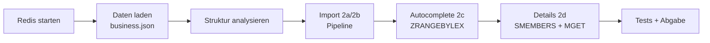
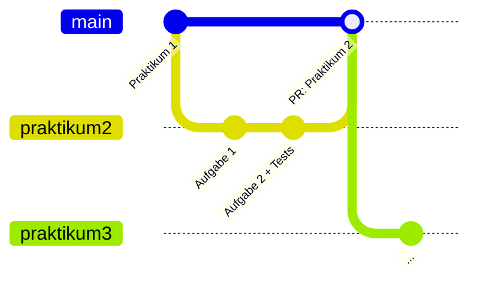

# Big Data Praktikum (HSBI, WS 2026/27)

[](https://github.com/leonryuu29/Big-Data-Praktikum/actions/workflows/praktikum1-tests.yml)
[](https://github.com/leonryuu29/Big-Data-Praktikum/actions/workflows/praktikum2-tests.yml)

Lösungen zu den Praktika der Vorlesung *Big Data* (Prof. Dr. Stefan Berlik).

| Praktikum | Thema | Status | Ordner |
|---|---|---|---|
| 1 | Redis: Datentypen, Yelp-Business-Daten, Autovervollständigung | ✅ fertig, 23/23 Tests | [`Praktikum1/`](Praktikum1/) |
| 2 | Cassandra: CQL, Architektur, MovieLens, abfragegetriebene Tabellen | ✅ fertig, 54/54 Tests | [`Praktikum2/`](Praktikum2/) |

## Praktikum 2 – Cassandra + MovieLens

| Datei | Inhalt |
|---|---|
| [`Abgabe.md`](Praktikum2/Abgabe.md) | Abgabe (Deutsch) mit allen Antworten und den Notizen zu Aufgabe 2 |
| [`TESTBERICHT.md`](Praktikum2/TESTBERICHT.md) | Testbericht: 5-stufige Testkette, Mutationstest |
| [`README.md`](Praktikum2/README.md) | Aufgabenanalyse, Workflow, Fortschritt, Entwurfsentscheidungen (Chinesisch) |

**Ergebnisse:** Nutzy 42 hat 440 Filme bewertet; die ersten 5 alphabetisch sind *20 Dates (1998)*, *2001: A Space Odyssey (1968)*, *2010: The Year We Make Contact (1984)*, *28 Days (2000)*, *8 Seconds (1994)*. „Toy Story (1995)“ wurde von 215 Nutzys bewertet.

**Schnellstart (Windows mit Docker Desktop):** `Praktikum2\deploy.bat` doppelklicken. Linux/macOS: `bash Praktikum2/scripts/run_praktikum2.sh`.

## Praktikum 1 – Redis + Yelp

| Datei | Inhalt |
|---|---|
| [`Abgabe.md`](Praktikum1/Abgabe.md) | Abgabe (Deutsch) mit allen Antworten |
| [`TESTBERICHT.md`](Praktikum1/TESTBERICHT.md) | Testbericht |
| [`README.md`](Praktikum1/README.md) | Aufgabenanalyse, Workflow, Fortschritt, Lösungsideen (Chinesisch) |
| [`aufgabe1_redis_cli.md`](Praktikum1/aufgabe1_redis_cli.md) | Aufgabe 1: redis-cli Fingerübungen |

**Ergebnisse auf echten Daten:** 192.609 Betriebe · Starbucks 1.066 (mit Präfix 1.073) · „The Still“ 2 Betriebe (Las Vegas 3,5★, Calgary 2,5★).

### Workflow



### Schnellstart

**Windows (ohne Docker):** im Ordner `Praktikum1` doppelklicken

| Datei | Zweck |
|---|---|
| `deploy.bat` | portables Redis laden & starten, redis-py installieren, Daten importieren, Antworten erzeugen |
| `run_tests.bat` | Tests ausführen |
| `redis-cli.bat` | redis-cli öffnen (Aufgabe 1) |
| `autocomplete.bat` | interaktive Suche (Aufgabe 2c/2d) |

**Mit Docker (wie in der Aufgabenstellung):**

```bash
docker run --name RedisPraktikum2026 -p 6379:6379 -d redis:latest
cd Praktikum1
pip install -r requirements.txt
python load_data.py data/business.json --flush
python answers.py
python -m unittest discover -s tests -v
```

Die Yelp-Daten (`business.json`, ~135 MB) liegen nicht im Repository; Download siehe `Praktikum1/scripts/download_data.ps1` bzw. Aufgabenblatt.

### Arbeitsweise mit Branches



| Branch | Zweck |
|---|---|
| `main` | nur fertige, getestete Praktika |
| `praktikumN` | Arbeit am Praktikum N → Pull Request nach `main`, Merge wenn CI grün |
| `fix/praktikumN-…` | Korrekturen an einem abgeschlossenen Praktikum |
| `setup/…` | CI, Vorlagen, Repository-Struktur |

Neues Praktikum starten:

```bash
git checkout main && git pull
git checkout -b praktikum2
# Ordner Praktikum2/ anlegen, arbeiten, committen
git push -u origin praktikum2   # dann Pull Request auf GitHub öffnen
```

Jeder Pull Request nutzt die Vorlage `.github/pull_request_template.md` (Checkliste für Abgabe, Tests, CI).

### Continuous Integration

Bei jedem Push/PR auf `Praktikum1/**` laufen die Tests per GitHub Actions gegen echte Redis-Container (Redis 5 und 7) mit Python 3.10 und 3.13. Die Tests auf dem vollständigen Datensatz werden in CI übersprungen, weil `business.json` nicht eingecheckt ist.
